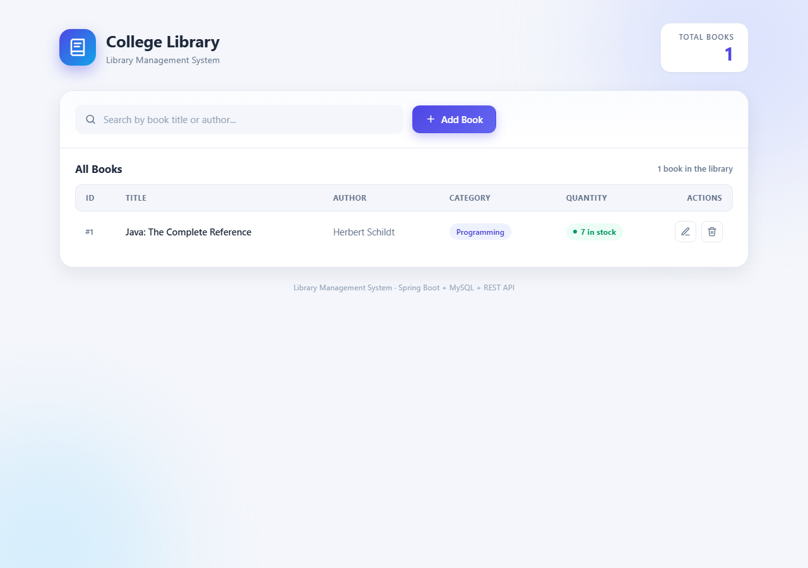
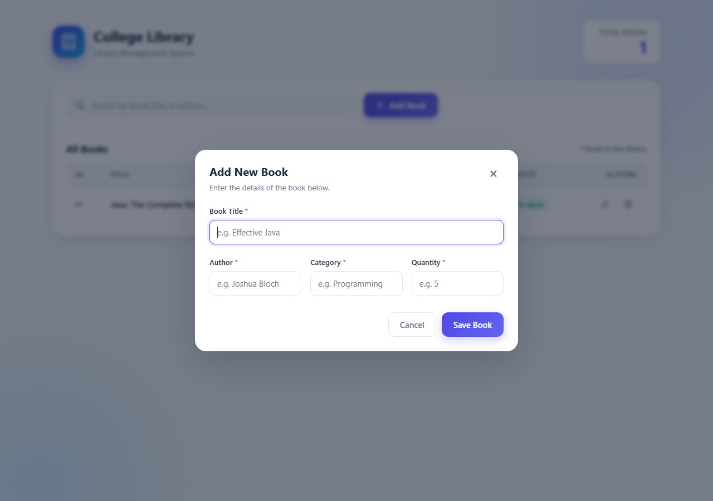
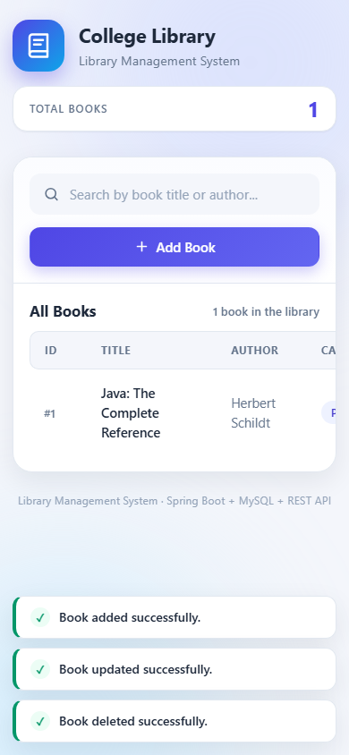

# Library Management System

A simple, complete **Library Management CRUD System** built for a college project.

| Layer    | Technology                          |
|----------|-------------------------------------|
| Frontend | HTML, CSS, JavaScript (vanilla)     |
| Backend  | Java 17+, Spring Boot 3.5, REST API |
| Database | MySQL 8                             |
| ORM      | Spring Data JPA (Hibernate)         |

No login or authentication. The application manages book inventory, student
records, and issue/return transactions.

---

## 1. Features

1. **Add** a new book
2. **View** all books
3. **Update** book details
4. **Delete** a book
5. **Search** books by title or author (case-insensitive)
6. **Total number of books** displayed in the header
7. **Student records** — add, view, update and delete by student ID and name
8. **Book issue and return** — link one copy to a student for 14 days, track due
   dates, and restore available stock when returned

Also included:

- Server-side validation (`@NotBlank`, `@Min`, `@Size`) with clear JSON errors
- Client-side validation with inline messages
- Friendly error handling (404, 400, network errors)
- Clean, responsive UI with modals and toast notifications
- Integration tests for every operation

---

## 2. Project structure

```
Library system/
├── backend/
│   ├── pom.xml
│   └── src/
│       ├── main/
│       │   ├── java/com/college/library/
│       │   │   ├── LibraryApplication.java
│       │   │   ├── config/
│       │   │   ├── controller/                    # book, student, issue APIs
│       │   │   ├── service/                       # business logic
│       │   │   ├── repository/                    # database access
│       │   │   ├── model/                         # JPA entities
│       │   │   └── exception/                     # API error handling
│       │   └── resources/application.properties
│       └── test/
│           ├── java/.../BookApiIntegrationTest.java
│           ├── java/.../StudentApiIntegrationTest.java
│           ├── java/.../IssueTransactionApiIntegrationTest.java
│           └── resources/application-test.properties
├── database/
│   └── library_db.sql                             # database creation script
├── frontend/
│   ├── index.html
│   ├── style.css
│   ├── script.js
│   └── favicon.svg
└── README.md
```

---

## 3. Prerequisites

- **JDK 17 or newer** (`java -version`)
- **MySQL 8** running on `localhost:3306`
- **Maven** (or use the included Maven Wrapper: `mvnw.cmd`)
- Any modern browser (Chrome, Edge, Firefox)

> IntelliJ IDEA / Eclipse / VS Code users can also import the `backend` folder
> as a Maven project and run `LibraryApplication.java`.

---

## 4. Database setup

### Option A — Run the SQL script (recommended)

```bash
# macOS / Linux / Git Bash
mysql -u root -p < database/library_db.sql
```

```powershell
# Windows PowerShell (run from the project folder)
Get-Content .\database\library_db.sql | & "C:\Program Files\MySQL\MySQL Server 8.0\bin\mysql.exe" -u root -p
```

If `mysql` is already on your PATH, the simpler command is:

```powershell
Get-Content .\database\library_db.sql | mysql -u root -p
```

Or open **MySQL Workbench**, paste the contents of `database/library_db.sql`
and execute it.

The script runs:

```sql
CREATE DATABASE IF NOT EXISTS library_db
    CHARACTER SET utf8mb4
    COLLATE utf8mb4_unicode_ci;

USE library_db;

CREATE TABLE IF NOT EXISTS books (
    id       BIGINT       NOT NULL AUTO_INCREMENT,
    title    VARCHAR(150) NOT NULL,
    author   VARCHAR(100) NOT NULL,
    category VARCHAR(80)  NOT NULL,
    quantity INT          NOT NULL,
    PRIMARY KEY (id)
);

CREATE TABLE IF NOT EXISTS students (
    id         BIGINT       NOT NULL AUTO_INCREMENT,
    student_id VARCHAR(30)  NOT NULL UNIQUE,
    name       VARCHAR(100) NOT NULL,
    PRIMARY KEY (id)
);

CREATE TABLE IF NOT EXISTS issue_transactions (
    id          BIGINT NOT NULL AUTO_INCREMENT,
    book_id     BIGINT NOT NULL,
    student_id  BIGINT NOT NULL,
    issue_date  DATE   NOT NULL,
    due_date    DATE   NOT NULL,
    return_date DATE   NULL,
    PRIMARY KEY (id),
    FOREIGN KEY (book_id) REFERENCES books (id),
    FOREIGN KEY (student_id) REFERENCES students (id)
);
```

### Option B — Let Spring Boot create it

The JDBC URL contains `createDatabaseIfNotExist=true` and Hibernate uses
`ddl-auto=update`, so the database and required tables are created automatically on
first startup. The SQL script is still useful for submission/documentation.

---

## 5. Configure MySQL credentials

Open `backend/src/main/resources/application.properties`:

```properties
spring.datasource.url=jdbc:mysql://localhost:3306/library_db?createDatabaseIfNotExist=true&useSSL=false&allowPublicKeyRetrieval=true&serverTimezone=UTC
spring.datasource.username=root
spring.datasource.password=root
```

Change the **username / password** to match your MySQL installation.
The password can also be supplied without editing the file:

```powershell
# Windows PowerShell
$env:DB_PASSWORD="your_mysql_password"
```

```bash
# macOS / Linux
export DB_PASSWORD=your_mysql_password
```

> Default values are `root` / `root`. If your MySQL root account has a
> different password, update it before starting the backend.

---

## 6. Run the backend

### Option A — Maven Wrapper (no Maven installation needed)

```powershell
cd backend
.\mvnw.cmd spring-boot:run
```

### Option B — Maven installed

```bash
cd backend
mvn spring-boot:run
```

### Option C — IDE

Open `backend/pom.xml` in IntelliJ IDEA / Eclipse, wait for dependencies,
then run `com.college.library.LibraryApplication`.

Backend starts at **http://localhost:8080**.

Quick check:

```bash
curl http://localhost:8080/api/books
```

Expected: `[]` (or sample books if you ran the SQL inserts).

---

## 7. Run the frontend

1. Open `frontend/index.html` in a browser (double-click works), **or**
2. In VS Code, right-click `index.html` → **Open with Live Server**, **or**
3. Serve it with Python:

```bash
cd frontend
python -m http.server 5500
```

Then visit **http://localhost:5500**.

CORS is already configured in `CorsConfig.java`, so the page can call
`http://localhost:8080/api/books` from any of these methods.

> The backend must be running before you add/search/delete books.
> If it is not, the UI shows a friendly "Could not load books" message.

---

## 8. REST API

Base URL: `http://localhost:8080`

| # | Method | Endpoint                  | Description                     | Success |
|---|--------|---------------------------|---------------------------------|---------|
| 1 | GET    | `/api/books`              | Get all books                   | 200     |
| 2 | GET    | `/api/books/{id}`         | Get one book                    | 200     |
| 3 | POST   | `/api/books`              | Add a book                      | 201     |
| 4 | PUT    | `/api/books/{id}`         | Update a book                   | 200     |
| 5 | DELETE | `/api/books/{id}`         | Delete a book                   | 204     |
| 6 | GET    | `/api/books/search?keyword=java` | Search by title or author | 200     |
| 7 | GET    | `/api/books/count`        | Total number of books           | 200     |
| 8 | GET    | `/api/students`           | List students                   | 200     |
| 9 | GET    | `/api/students/{id}`      | Get one student                 | 200     |
| 10 | POST  | `/api/students`           | Add a student                   | 201     |
| 11 | PUT   | `/api/students/{id}`      | Update a student                | 200     |
| 12 | DELETE | `/api/students/{id}`     | Delete a student                | 204     |
| 13 | GET    | `/api/issues`            | List issue/return history       | 200     |
| 14 | POST   | `/api/issues`            | Issue one available book        | 201     |
| 15 | PUT    | `/api/issues/{id}/return` | Return an issued book          | 200     |

Student IDs must be unique (case-insensitive). The `students` table is separate
from `books`; adding it does not delete or rewrite existing book records.
An issue request body contains `bookId` and `studentId`. An issue is due 14 days
after it is created. Issuing decrements available book
quantity; returning increments it. Books or students with issue history cannot
be deleted, preserving the transaction records.

Issue request example:

```json
{
  "bookId": 1,
  "studentId": 1
}
```

### Request body

```json
{
  "title": "Effective Java",
  "author": "Joshua Bloch",
  "category": "Programming",
  "quantity": 5
}
```

### Example responses

`GET /api/books/count`

```json
{ "count": 4 }
```

Validation error (`400 Bad Request`):

```json
{
  "timestamp": "2026-11-10T20:00:00",
  "status": 400,
  "message": "Please correct the highlighted fields",
  "errors": {
    "title": "Title is required",
    "quantity": "Quantity cannot be negative"
  }
}
```

Not found (`404 Not Found`):

```json
{
  "timestamp": "2026-11-10T20:00:00",
  "status": 404,
  "message": "Book not found with id 99"
}
```

### cURL examples

```bash
# Add
curl -X POST http://localhost:8080/api/books \
  -H "Content-Type: application/json" \
  -d '{"title":"Clean Code","author":"Robert C. Martin","category":"Programming","quantity":3}'

# View all
curl http://localhost:8080/api/books

# Update
curl -X PUT http://localhost:8080/api/books/1 \
  -H "Content-Type: application/json" \
  -d '{"title":"Clean Code","author":"Robert C. Martin","category":"Programming","quantity":6}'

# Search
curl "http://localhost:8080/api/books/search?keyword=martin"

# Count
curl http://localhost:8080/api/books/count

# Delete
curl -X DELETE http://localhost:8080/api/books/1
```

---

## 9. Testing

Automated integration tests cover create, read, update, delete, search,
count, validation errors and 404 errors. They use an in-memory H2 database,
so **MySQL does not need to be running** for the tests.

```powershell
cd backend
.\mvnw.cmd test
```

Expected output ends with:

```
Tests run: 7, Failures: 0, Errors: 0, Skipped: 0
BUILD SUCCESS
```

### Manual test checklist

| Step | Action | Expected result |
|------|--------|-----------------|
| 1 | Start backend, open frontend | Table loads, total count shown |
| 2 | Click **Add Book**, submit valid data | Green toast, new row appears, count +1 |
| 3 | Submit empty form | Inline field errors, request not sent |
| 4 | Enter quantity `-2` | "Quantity cannot be negative." |
| 5 | Click **Edit**, change title/quantity, save | Row updates, toast shown |
| 6 | Type part of a title in search | Matching rows only |
| 7 | Type an author name in search | Matching rows only |
| 8 | Search for `zzzz` | "No matching books" empty state |
| 9 | Click **Delete**, confirm | Row removed, count −1 |
| 10 | Stop backend, reload page | Friendly error state + **Try Again** |
| 11 | Call `/api/books/9999` | 404 JSON error |

---

## 10. How it works (short explanation for viva)

1. `BookController` receives HTTP requests under `/api/books`.
2. `@Valid` triggers Bean Validation on the `Book` entity; invalid data never
   reaches the service layer.
3. `BookService` contains the business logic and throws
   `ResourceNotFoundException` when an id does not exist.
4. `BookRepository` extends `JpaRepository`, which provides `save`, `findAll`,
   `findById`, `delete`, `count` and the derived search query.
5. Hibernate maps the `Book` entity to the `books` table in MySQL.
6. `GlobalExceptionHandler` converts exceptions into clean JSON with the right
   HTTP status.
7. The frontend calls the API with `fetch()` and updates the table without a
   page reload.

---

## 11. Troubleshooting

| Problem | Fix |
|---------|-----|
| `Access denied for user 'root'@'localhost'` | Update the password in `application.properties` or set `DB_PASSWORD` |
| `Communications link failure` | Make sure the MySQL service is running on port 3306 |
| Frontend shows "Could not load books" | Start the backend and confirm http://localhost:8080/api/books opens |
| `Port 8080 already in use` | Stop the other process or change `server.port` |
| CORS error in browser console | Use the provided `CorsConfig` (already included) and restart the backend |
| Table not created | Check `ddl-auto=update` and database permissions, or run `library_db.sql` |

---

## 12. Screenshots

| Book list | Add / edit book |
|-----------|-----------------|
|  |  |



---

## 13. Possible viva questions

- **What is the difference between Controller, Service and Repository?**
  Controller handles HTTP, Service holds business rules, Repository talks to the database.
- **Why use Spring Data JPA?** It removes boilerplate SQL/DAO code and provides
  ready-made CRUD plus derived query methods.
- **How is validation done?** Bean Validation annotations on the entity and
  `@Valid` in the controller; errors are returned as JSON by the exception handler.
- **Why `@Transactional`?** Ensures database operations run inside a transaction
  and roll back on failure.
- **How does search work?** The method name
  `findByTitleContainingIgnoreCaseOrAuthorContainingIgnoreCase` is parsed by
  Spring Data JPA into a `LIKE` query with `LOWER()`.

---

Built as a 10-mark college project — simple, complete and easy to explain.
